# Terraform-Based AWS High-Availability Web Infrastructure with Auto Scaling and Monitoring


-FF9900?logo=amazonaws&logoColor=white)


A modular Terraform project that deploys a **highly available, self-healing, auto-scaling web tier** on AWS (region **ap-south-1 / Mumbai**). A static Apache website runs on an **Auto Scaling Group** spread across multiple Availability Zones behind an **Application Load Balancer**. **CloudWatch** alarms scale the fleet on average CPU utilization and notify you by email through **Amazon SNS**.

Every claim in this README is backed by a real screenshot from a live deployment (see [Proof of Working](#proof-of-working)).

---

## Table of Contents

- [Highlights](#highlights)
- [Architecture](#architecture)
- [Tech Stack](#tech-stack)
- [Project Structure](#project-structure)
- [Prerequisites](#prerequisites)
- [Quick Start](#quick-start)
- [How to Verify Everything Works](#how-to-verify-everything-works)
- [Proof of Working](#proof-of-working)
- [Results Summary](#results-summary)
- [Remote State (Recommended)](#remote-state-recommended)
- [Troubleshooting & Lessons Learned](#troubleshooting--lessons-learned)
- [Destroy](#destroy)
- [Cost & Security Notes](#cost--security-notes)
- [Possible Improvements](#possible-improvements)
- [Author](#author)

---

## Highlights

| Capability | How it is implemented |
|---|---|
| **Infrastructure as Code** | Reusable Terraform modules with separate `dev` and `prod` environments |
| **Auto Scaling** | Scale **out** at average CPU ≥ 40% (1-minute period), scale **in** at ≤ 20% for 5 consecutive minutes |
| **High Availability** | Instances spread across multiple Availability Zones behind the ALB |
| **Load Balancing** | Application Load Balancer, target group and HTTP health checks |
| **Self-Healing** | ASG uses ELB health checks and automatically replaces unhealthy or terminated instances |
| **Email Alerts** | CloudWatch scale-out alarm publishes to an SNS email subscription |
| **Fast Metrics** | EC2 detailed monitoring (1-minute metrics) for quicker alarm detection |
| **Secure Access** | Session Manager (no SSH, no key pair needed), IMDSv2 enforced, encrypted gp3 volumes |
| **Least-Privilege Networking** | EC2 instances accept HTTP **only from the ALB security group** |
| **Remote State** | Optional S3 backend with DynamoDB state locking |

## Architecture

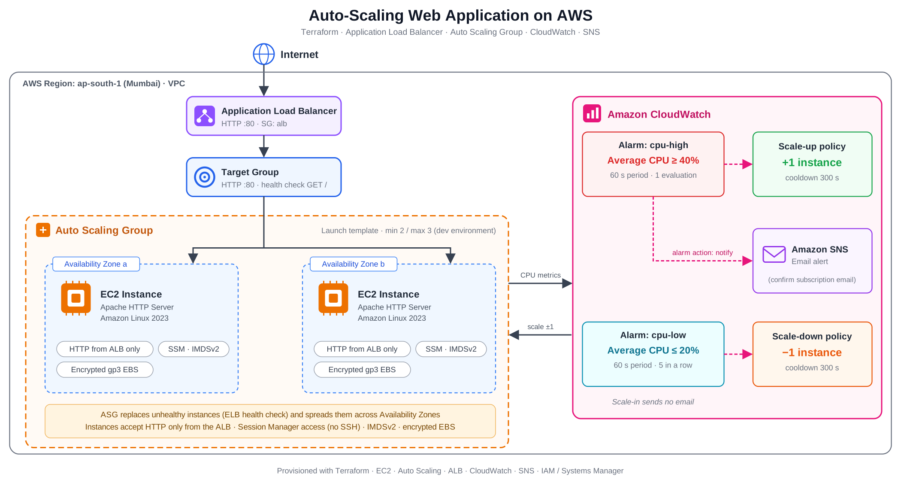

**Scaling behavior**

- **Scale out:** When average CPU reaches 40% (1-minute period), the `cpu-high` alarm adds one EC2 instance and sends an email through SNS.
- **Scale in:** When average CPU stays at 20% or lower for 5 consecutive minutes, the `cpu-low` alarm removes one EC2 instance. No email is sent on scale-in.
- **Cooldown:** 300 seconds between scaling actions to avoid flapping.

## Tech Stack

Terraform · AWS EC2 · Auto Scaling · Application Load Balancer · CloudWatch · SNS · IAM · Systems Manager (Session Manager) · S3 and DynamoDB (remote state) · Amazon Linux 2023 · Apache HTTP Server

## Project Structure

```text
terraform-autoscaling-aws-project/
├── README.md
├── Makefile                          # make plan/apply/destroy ENV=dev|prod
├── .gitignore
├── .editorconfig
├── docs/
│   ├── architecture.png              # architecture diagram
│   └── screenshots/                  # proof screenshots used in this README
├── scripts/
│   └── bootstrap-backend.sh          # creates S3 + DynamoDB for remote state
└── terraform/
    ├── modules/
    │   ├── networking/               # VPC / subnet lookup
    │   ├── security/                 # ALB + instance security groups
    │   ├── iam/                      # SSM instance role + profile
    │   ├── alb/                      # load balancer, target group, listener
    │   ├── compute/                  # launch template, ASG, scaling policies
    │   │   └── files/user_data.sh    # installs Apache + demo page
    │   └── monitoring/               # SNS + CloudWatch alarms
    └── environments/
        ├── dev/                      # t3.micro, 2-3 instances
        └── prod/                     # t3.small, 2-6 instances, ALB deletion protection
```

Each environment contains `main.tf`, `variables.tf`, `providers.tf`, `versions.tf`, `backend.tf`, `outputs.tf` and a `terraform.tfvars.example`.

## Prerequisites

- **Terraform** >= 1.3 and **AWS CLI** installed.
- AWS credentials with permissions for EC2, ELB, IAM, SNS, CloudWatch and Auto Scaling (`aws configure` or an IAM role).
- A **default VPC in `ap-south-1` with at least two subnets in different Availability Zones** (an ALB requirement). Otherwise set `vpc_id` / `subnet_ids` in `terraform.tfvars`.
  Missing default subnets can be created with:

  ```bash
  aws ec2 create-default-subnet --availability-zone ap-south-1a --region ap-south-1
  aws ec2 create-default-subnet --availability-zone ap-south-1b --region ap-south-1
  ```

## Quick Start

```bash
git clone https://github.com/shakil-ahmx/Terraform-AWS-Autoscaling-Selfhealing
cd terraform-autoscaling-aws-project/terraform/environments/dev

cp terraform.tfvars.example terraform.tfvars
# Edit terraform.tfvars and set alert_email to your real email address

terraform init
terraform validate
terraform plan
terraform apply
```

Or from the repository root:

```bash
make plan ENV=dev
make apply ENV=dev
```

The dev environment starts with 2 EC2 instances and can scale up to 3:

| Setting | Value |
|---|---:|
| Instance type | t3.micro |
| Minimum instances | 2 |
| Desired instances | 2 |
| Maximum instances | 3 |

**After deployment**

1. Open the `alb_url` output in a browser and allow 2-3 minutes for the instances to become healthy.
2. **Confirm the SNS email subscription** from your inbox (check spam). Without this, no alert emails are delivered.

## How to Verify Everything Works

### 1. Load balancing

```bash
ALB=$(terraform output -raw alb_url)
for i in $(seq 1 10); do curl -s "$ALB" | grep -o 'i-[0-9a-f]\{8,\}'; done
```

Different instance IDs alternate in the output, which confirms requests are distributed across instances.

### 2. Auto Scaling Group, targets and alarms

```bash
aws autoscaling describe-auto-scaling-groups --auto-scaling-group-names demo-dev-asg --region ap-south-1 \
  --query "AutoScalingGroups[0].{Min:MinSize,Desired:DesiredCapacity,Max:MaxSize,Instances:Instances[].[InstanceId,AvailabilityZone,HealthStatus]}"

aws cloudwatch describe-alarms --alarm-name-prefix demo-dev --region ap-south-1 \
  --query "MetricAlarms[].[AlarmName,StateValue]" --output table
```

### 3. Test scale-out

Connect to an instance via **EC2 Console → Connect → Session Manager** and generate CPU load:

```bash
sudo stress-ng --cpu 2 --timeout 600 &
```

Within a few minutes the `cpu-high` alarm enters ALARM, the ASG launches an additional instance (up to the maximum) and an email is sent through SNS.

### 4. Test scale-in

Stop the load (`sudo pkill stress-ng`). After CPU stays at or below 20% for 5 consecutive minutes, the `cpu-low` alarm triggers and the ASG removes one instance.

```bash
aws autoscaling describe-scaling-activities --auto-scaling-group-name demo-dev-asg --region ap-south-1 \
  --max-items 6 --query "Activities[].[StartTime,Description,StatusCode]" --output table
```

### 5. Test self-healing

Manually terminate one instance (EC2 Console → Instance state → Terminate). The ASG detects the capacity shortfall and launches a replacement automatically.

---

## Proof of Working

All screenshots below were captured from a live deployment in `ap-south-1`.

### 1. Infrastructure deployed with Terraform

`terraform apply` completed successfully and exposed the ALB URL, ASG name, AMI and SNS topic as outputs.

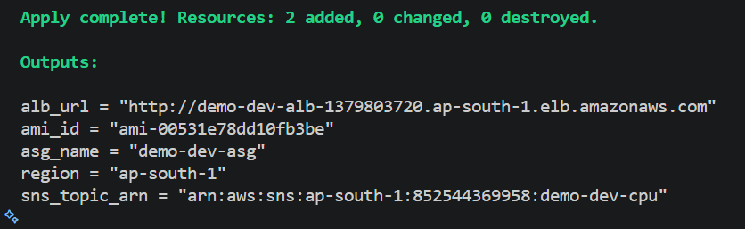

### 2. SNS email subscription

The SNS topic `demo-dev-cpu` sent a subscription confirmation email. After confirming it, alarm notifications are delivered (see [step 8](#8-email-alert-received-via-sns)).

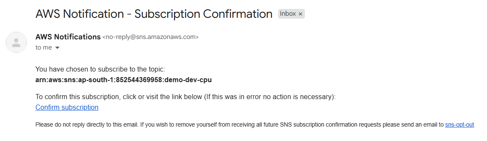

### 3. Load balancing across Availability Zones

Refreshing the ALB URL is served by different EC2 instances in different Availability Zones.

| Instance A (ap-south-1a) | Instance B (ap-south-1b) |
|---|---|
|  |  |

### 4. Healthy targets behind the ALB

Both registered targets pass health checks and sit in two different Availability Zones (`ap-south-1a` and `ap-south-1b`).

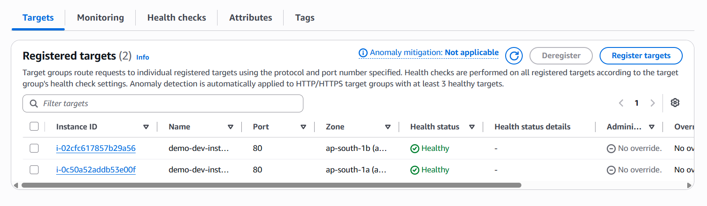

### 5. Auto Scaling Group configuration

Desired capacity 2, scaling limits 2-3, `t3.micro`, status **At desired capacity**.

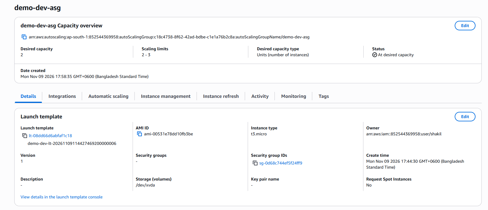

### 6. CloudWatch alarms

Both alarms are active with actions enabled:

- `demo-dev-cpu-high`: CPUUtilization >= 40 for 1 datapoint within 1 minute
- `demo-dev-cpu-low`: CPUUtilization <= 20 for 5 datapoints within 5 minutes

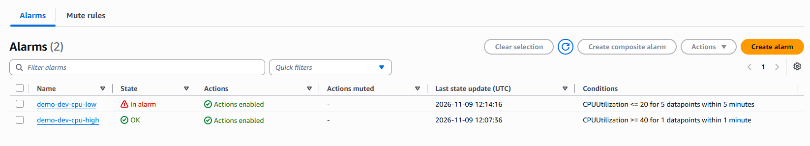

### 7. Scale-out under CPU load

CPU utilization crossed the 40% threshold and the `cpu-high` alarm entered the **In alarm** state.

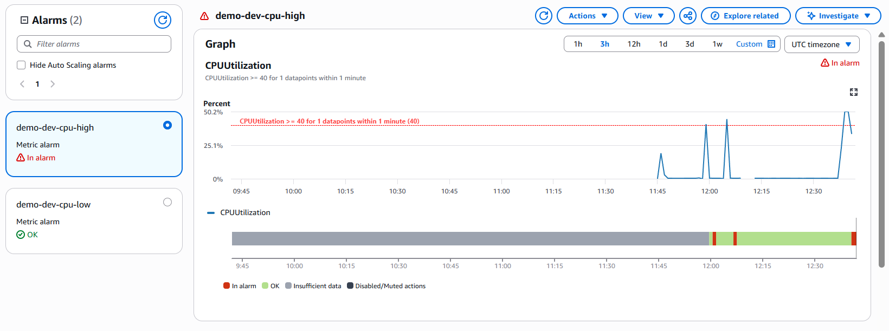

The alarm triggered the `demo-dev-scale-up` policy, which raised the desired capacity from **2 to 3** and launched a new instance within seconds.

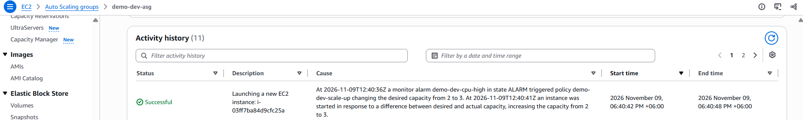

Three instances running across two Availability Zones, all passing 3/3 status checks (older terminated instances are from earlier test runs).

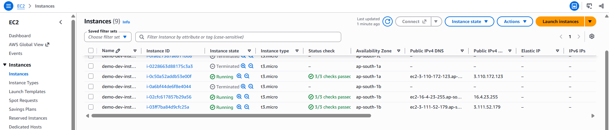

### 8. Email alert received via SNS

The alarm state change (`OK -> ALARM`) was delivered by email, reporting a CPU datapoint of about 50.2% against the 40% threshold.

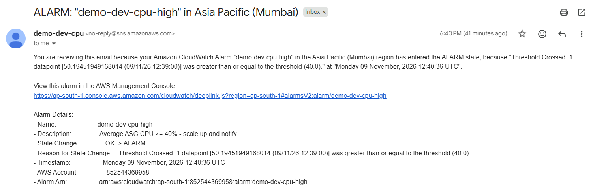

### 9. Scale-in after CPU load drops

Once the load stopped and CPU stayed at or below 20%, the `cpu-low` alarm entered the **In alarm** state, triggering the scale-in policy.

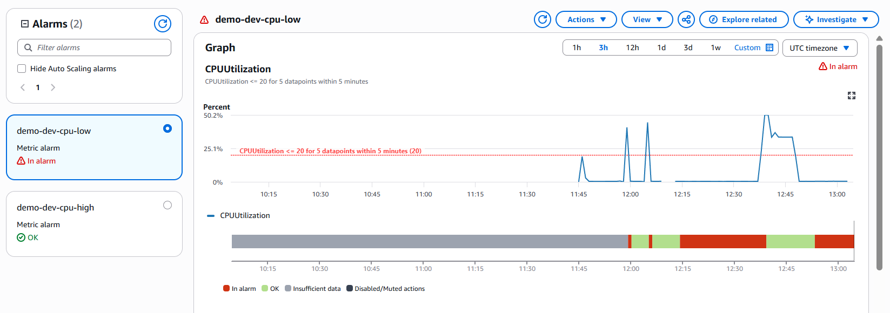

### 10. Self-healing: terminated instance automatically replaced

After an instance was terminated manually, only one instance remained running (below the ASG minimum of 2):

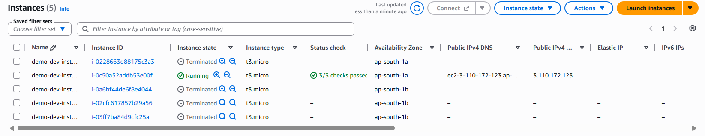

The Auto Scaling Group immediately launched a replacement instance (`i-04c4f49343eb77fbc`, status *Initializing*) without any manual action:

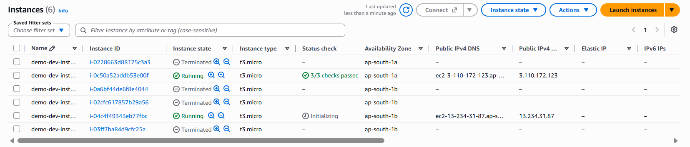

---

## Results Summary

| # | Test | Expected | Observed |
|---|---|---|---|
| 1 | Deployment | Infrastructure created by Terraform | `Apply complete!` with ALB URL output |
| 2 | Load balancing | Traffic served by multiple instances | Two different instance IDs in two AZs |
| 3 | Health checks | All targets healthy | 2/2 targets **Healthy** |
| 4 | Scale out | CPU >= 40% adds one instance | Alarm fired at ~50% CPU, desired capacity **2 → 3** |
| 5 | Notification | Email on scale-out alarm | `OK -> ALARM` email received via SNS |
| 6 | Scale in | CPU <= 20% for 5 min removes one instance | `cpu-low` alarm entered ALARM after load stopped |
| 7 | Self-healing | Terminated instance replaced | New instance launched automatically |

## Remote State (Recommended)

Create the S3 bucket and DynamoDB lock table once per account:

```bash
./scripts/bootstrap-backend.sh
```

Then uncomment the backend block in `terraform/environments/<env>/backend.tf`, set the bucket name printed by the script, and migrate the state:

```bash
terraform init -migrate-state
```

## Troubleshooting & Lessons Learned

| Problem | Cause and fix |
|---|---|
| `At least two subnets in two different Availability Zones must be specified` during ALB creation | The default VPC contained only one subnet. An ALB needs subnets in at least two AZs. Create the missing default subnets (see [Prerequisites](#prerequisites)) or pass `subnet_ids`, then run `terraform apply` again. Terraform resumed from the partially created state and completed the remaining resources. |
| Targets stay `unhealthy` / ALB returns 502-503 | Wait 2-3 minutes. Apache is installed by `user_data.sh` at boot; the ASG health-check grace period is 120 seconds. |
| Session Manager "Connect" is disabled | The SSM agent needs a few minutes to register. Verify the instance profile has `AmazonSSMManagedInstanceCore`. |
| No alert emails | The SNS subscription is still *Pending*. Confirm it from the email (check spam). |
| Resources not visible in the AWS Console | Switch the Console region to **Asia Pacific (Mumbai) `ap-south-1`**. |

**Key takeaways**

- Scale-out reacts quickly (1-minute evaluation) to absorb traffic spikes, while scale-in waits 5 minutes to avoid removing capacity too eagerly.
- `health_check_type = "ELB"` makes the ASG replace instances that fail application-level health checks, not only those that crash at the EC2 level.
- Terraform state is resilient to partial failures: fixing the root cause and re-running `apply` is enough.

## Destroy

```bash
make destroy ENV=dev
```

Verify in the Console that the EC2 instances, ALB and Auto Scaling Group are gone.

> **Note:** The production environment has ALB deletion protection enabled. Set `enable_deletion_protection = false`, apply, and only then destroy.

## Cost & Security Notes

- **Costs:** The Application Load Balancer, EC2 instances and CloudWatch alarms are billable. Destroy unused environments to avoid unnecessary charges.
- **AMI:** The latest Amazon Linux 2023 AMI is looked up automatically. Set `ami_id` to use a custom AMI.
- **Network security:** EC2 instances accept HTTP traffic only from the ALB security group. No SSH port is open.
- **Instance hardening:** IMDSv2 is enforced and EBS volumes are encrypted.
- **Secrets hygiene:** `terraform.tfvars` and `*.tfstate` are excluded by `.gitignore`. Never commit them: they can contain your email address and AWS account details.

## Possible Improvements

- Add HTTPS with an ACM certificate and an HTTP → HTTPS redirect on the ALB.
- Move instances to private subnets behind NAT gateways or VPC endpoints.
- Switch to a target-tracking scaling policy on `ALBRequestCountPerTarget`.
- Add a CloudWatch dashboard and an alarm on unhealthy host count.
- Add CI (GitHub Actions) running `terraform fmt`, `validate`, `tflint` and `tfsec`.

## Author

**<Your Name>**
GitHub: [@shakil-ahmx](https://github.com/shakil-ahmx) · LinkedIn: [@shakil-ahmx](https://www.linkedin.com/in/shakil-ahmx)